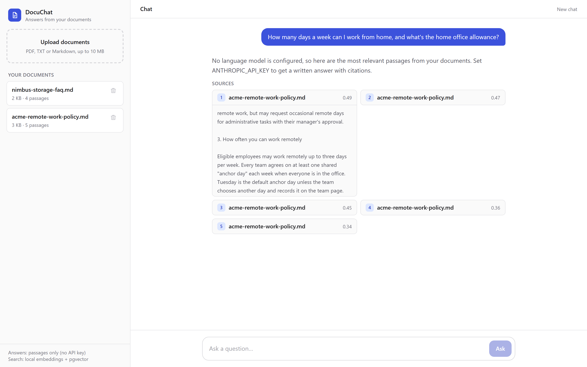
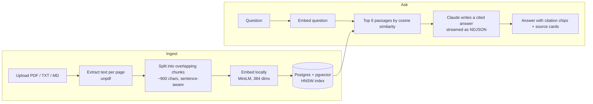

# DocuChat: chat with your documents

Upload PDFs, text or Markdown files and ask questions about them. DocuChat finds the relevant passages with vector search and has Claude write a short answer that cites them. Every `[1]` in an answer links to the passage it came from, so you can check it.



## Features

- **Cited answers.** Answers are grounded only in your documents. Each claim carries a citation chip that jumps to the source passage, with the document name, page number and similarity score.
- **Says "I don't know".** If nothing in your documents matches, it says so instead of making something up.
- **PDF, TXT and Markdown.** PDFs are read page by page, so citations point to the right page.
- **Local embeddings.** Documents are embedded on the server with `all-MiniLM-L6-v2` (ONNX, via Transformers.js), so indexing costs nothing and document text isn't sent anywhere just to be indexed.
- **Works without an API key.** Without `ANTHROPIC_API_KEY`, DocuChat still searches your documents and shows the best passages. Add a key and Claude writes the answers.
- **Streaming.** Sources appear first and the answer streams in token by token.
- **Follow-up questions.** Recent turns are sent with each question, so "what about contractors?" works.
- **Light and dark mode, and mobile layout.**
- **Tested.** Unit tests for the chunker (Vitest) and end-to-end tests for upload, delete, validation and chat (Playwright).

## How it works



1. **Ingest.** Text is extracted per page, then split into ~900-character chunks with 150 characters of overlap. Splits prefer paragraph and sentence boundaries, and chunks never span pages, so every passage has one page to cite.
2. **Index.** Each chunk is embedded and stored in Postgres with pgvector. An HNSW index keeps search fast as the collection grows.
3. **Retrieve.** The question is embedded the same way, and the six nearest chunks are fetched. Passages below a similarity threshold are dropped, so unrelated questions don't get answers built on noise.
4. **Answer.** The passages are numbered and sent to Claude with instructions to answer only from them and cite every claim. The API route streams newline-delimited JSON: the sources first, then text deltas.

## Tech stack

| Layer | Technology |
|---|---|
| Frontend | Next.js 16 (App Router), React 19, TypeScript, Tailwind CSS 4 |
| API | Next.js route handlers, Zod validation, NDJSON streaming |
| AI | Claude via the Anthropic SDK (streaming), Transformers.js embeddings |
| Data | PostgreSQL 17 + pgvector (HNSW, cosine distance) |
| Testing | Vitest, Playwright |
| Dev | Docker Compose |

## Run it locally

Requirements: Node.js 20+ and Docker.

```bash
npm install
cp .env.example .env          # optionally add ANTHROPIC_API_KEY
docker compose up -d db       # Postgres + pgvector on port 5433
npm run dev                   # http://localhost:3100
```

The first start downloads the embedding model (about 90 MB) and caches it. Two sample documents are in [`samples/`](samples/) to try it with.

## Tests

```bash
npm test             # unit tests (chunking)
npm run test:e2e     # end-to-end tests; starts the dev server if one isn't running
```

The end-to-end tests run against a real database and the real embedding model. They create uniquely named documents and delete them afterwards, so they don't touch your own uploads.

## API

| Method | Path | Description |
|---|---|---|
| `GET` | `/api/documents` | List documents |
| `POST` | `/api/documents` | Upload a document (`multipart/form-data`, field `file`) |
| `DELETE` | `/api/documents/:id` | Delete a document and its passages |
| `POST` | `/api/chat` | `{ question, history? }`; streams `sources`, `text`, `done` or `error` events as NDJSON |
| `GET` | `/api/status` | Which answer model and embedding model are active |

## Project structure

```
src/
  app/
    api/            route handlers (documents, chat, status)
    page.tsx        app state, upload and streaming client
  components/       Sidebar, Chat, Answer (citations + source cards)
  lib/
    extract.ts      PDF / text extraction per page
    chunk.ts        sentence-aware chunking with overlap (+ tests)
    embeddings.ts   local embedding model
    db.ts           connection pool and schema
    store.ts        ingest, list, delete, vector search
    answer.ts       Claude prompt and streaming
e2e/                Playwright tests
samples/            example documents
```

## Limitations and next steps

- Scanned PDFs without a text layer need OCR first; DocuChat reports these instead of indexing nothing.
- There's no authentication: every visitor sees the same document library. Per-user libraries would come next.
- Retrieval is pure vector search. Adding keyword search (hybrid BM25 + vectors) and a re-ranker would help with exact terms such as product codes.
